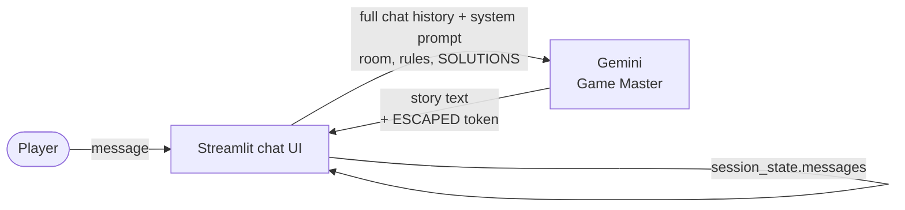
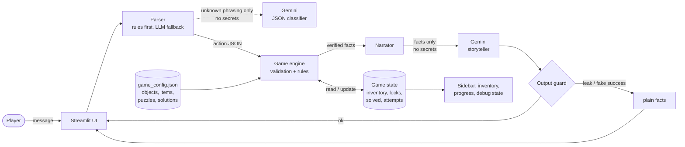
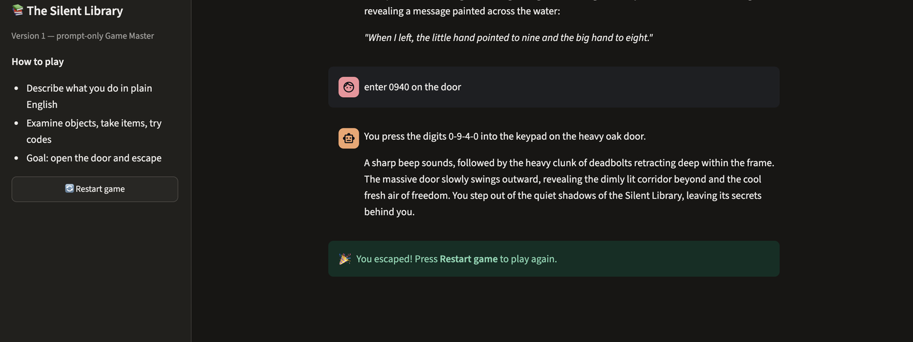
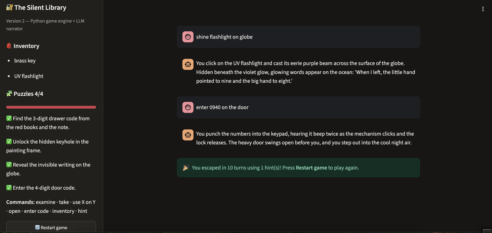

# AI Escape Room — The Silent Library

A text-based escape room where a Large Language Model (Google Gemini) acts as the Game Master.
You wake up in a locked library at night and have to examine objects, collect items and solve
puzzles to escape.

The project is built in two versions:

| | Version 1 — Interactive | Version 2 — Reliable |
|---|---|---|
| Who decides if an action works? | The LLM | Python game engine |
| Where is the game state? | Only in the chat history | Structured dict (JSON-serialisable) |
| Where are the solutions? | In the LLM's system prompt | In `game_config.json`, never sent to the LLM |
| Role of the LLM | Rules + memory + storytelling | Storytelling (+ fallback input parsing) |
| Prompt injection / cheating | Not handled (out of scope) | Rejected by design + tested |

## The problem

LLMs are great at describing a world, but bad at being the *referee* of one. In Version 1 the
model can forget what happened, invent objects, give away clues too early or simply be talked
into opening the door. Version 2 keeps the creative part in the LLM and moves every rule into
deterministic Python code.

## The game

**Room:** a private library with 7 interactive objects — desk, bookshelf, drawer, painting,
globe, grandfather clock, door — and 3 collectable items — note, brass key, UV flashlight.

**Puzzle chain**

1. **Drawer (3-digit code).** The note says *"read the red books from the shortest to the tallest"*.
   The bookshelf shows three red books with numbers in their titles and different heights.
2. **Painting (item).** The drawer contains a brass key that fits a hidden keyhole in the
   painting's frame. Behind it: a UV flashlight.
3. **Globe (item).** Under UV light, invisible writing appears on the globe telling where the
   clock's missing hands pointed.
4. **Door (4-digit code, final).** Turn that time into a 4-digit code and escape.

> Spoiler-free: solutions are in `v2/game_config.json` and `v1/prompts.py`.

## Architecture

### Version 1



One system prompt contains the room, the rules and the solutions. Each turn the whole chat
history is sent to Gemini. The app only checks for the `[GAME_OVER: ESCAPED]` token.

### Version 2



Turn flow: **parse → validate & update state → narrate → guard**.

- `v2/parser.py` — regex/alias parser handles normal commands without an API call. Only unclear
  messages go to Gemini in JSON mode; its output is sanitised against known ids.
- `v2/engine.py` — every action (`examine`, `take`, `use`, `enter_code`, `open`, `inventory`,
  `hint`, `meta`) is a Python function that checks the state and returns a `Result` with facts.
- `v2/state.py` — the game state dict.
- `v2/narrator.py` — Gemini turns facts into prose. It never sees the solutions. A guard falls
  back to the plain facts if the text contains a secret code or claims a success that did not
  happen.

## Project structure

```
AI-Escape-Room/
├── v1/
│   ├── app.py            # Streamlit app, prompt-only Game Master
│   └── prompts.py        # system prompt with room + solutions
├── v2/
│   ├── app.py            # Streamlit app with state sidebar
│   ├── game_config.json  # room, items, puzzles, solutions, hints
│   ├── state.py          # game state
│   ├── engine.py         # action validation + rules
│   ├── parser.py         # text → action JSON
│   ├── narrator.py       # LLM narration + output guard
│   └── llm.py            # Gemini wrapper
├── tests/test_engine.py  # 16 offline tests (no API key needed)
├── docs/
│   ├── REPORT.md         # design, problems, improvements
│   ├── TEST_CASES.md     # V1 vs V2 test cases
│   └── screenshots/
├── run_in_colab.ipynb     # run both apps from Google Colab
├── .env.example
└── requirements.txt
```

## Installation

Requires Python 3.10+ and a free Gemini API key from [Google AI Studio](https://aistudio.google.com/apikey).

```bash
git clone https://github.com/elifsila/AI-Escape-Room.git
cd AI-Escape-Room
python -m venv .venv
source .venv/bin/activate          # Windows: .venv\Scripts\activate
pip install -r requirements.txt
cp .env.example .env               # then put your key in .env
```

## Running

```bash
streamlit run v1/app.py    # Version 1
streamlit run v2/app.py    # Version 2
pytest -v                  # Version 2 tests, no API key needed
```

Version 2 can also run without any API calls: set `OFFLINE_MODE=1` in `.env`. The game is fully
playable; answers are the plain engine facts instead of LLM narration.

**Google Colab (no local Python needed):**
[](https://colab.research.google.com/github/elifsila/AI-Escape-Room/blob/main/run_in_colab.ipynb)
Add `GEMINI_API_KEY` to Colab Secrets, then run the cells. The notebook clones this repo, runs the
tests and starts each app behind a temporary `trycloudflare.com` link.

**Commands (V2):** `examine <object>`, `take <item>`, `use <item> on <object>`, `open <object>`,
`enter <code> on <object>`, `inventory`, `hint`, `look`. Natural phrasing like
*"I want to shine the light at the globe"* also works.

## Testing

See [docs/TEST_CASES.md](docs/TEST_CASES.md) for the test cases comparing V1 and V2
(collecting a key you don't have, wrong codes, fake progress claims, admin impersonation,
asking for the solutions, nonexistent objects…). The V2 cases are automated in
`tests/test_engine.py`.

## Screenshots

| Version 1 | Version 2 |
|---|---|
|  |  |

## Limitations

- One room only; the engine is generic, but new puzzle *types* need new Python code.
- The rule-based parser understands English only; other phrasings go to the LLM fallback.
- On the free Gemini tier, rate limits are low. V2 uses at most 2 calls per turn (usually 1),
  and `OFFLINE_MODE` needs none.
- The output guard is a simple regex check; it can be too strict (falls back to plain text)
  but it never lets the LLM change the game state.

## Tech stack

Python · Streamlit · Google Gemini API (`google-genai`) · pytest
